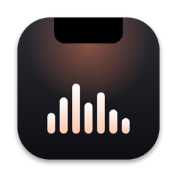
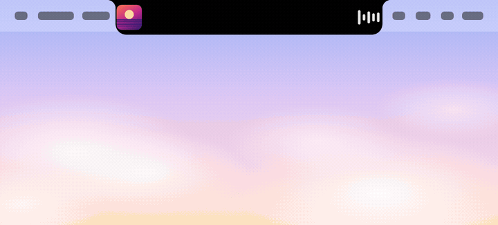
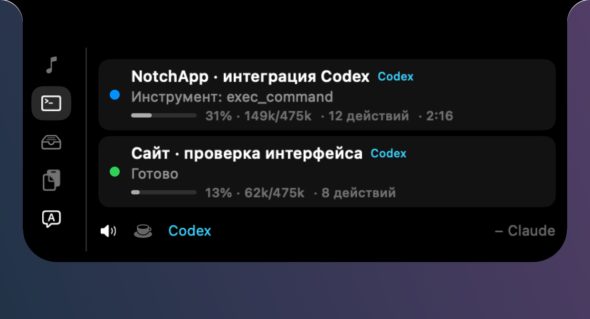
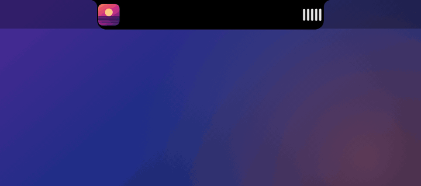
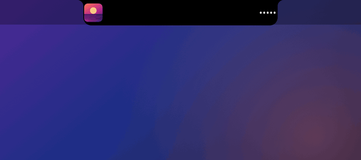

<p align="center"></p>

<h1 align="center">NotchApp</h1>

<p align="center">
  <b>The MacBook notch, put to work.</b><br>
  Music, Claude and Codex agents, files, clipboard and a translator — in one place, a mouse movement away.
</p>

<p align="center">
  <a href="README.md">Русский</a> · English
</p>

<p align="center">
  
  
  
</p>

https://github.com/user-attachments/assets/722a7192-80ab-436c-81ed-118ec454bda8

<p align="center"><sub>If the video doesn't load, you can download it: <a href="docs/promo.mp4">docs/promo.mp4</a></sub></p>

---

## What it is

NotchApp turns the MacBook notch into a small control panel. Collapsed, it is almost invisible and only shows artwork with an equalizer while music plays. Move the cursor to the notch and it smoothly expands: five tabs, each for its own job. Move away and it folds back.

The idea: **everything you'd normally hunt for across windows is within reach** and stays out of the way until needed. It is especially handy when several Claude and Codex agents run in parallel: their status and context usage are visible in one tab. Claude also supports answering questions and permission prompts from the notch; Codex cards open the corresponding chat.

| Tab | What for |
|---|---|
|  **Music** | What's playing, controls, seeking, an equalizer |
|  **Agents: Claude + Codex** | Chat status and context; Claude replies, questions and permissions; Codex links to the chat |
|  **Files** | Screenshots and a "shelf" for files you need to move somewhere |
|  **Clipboard** | History of copied text |
|  **Translate** | Quick RU ↔ EN translation |

---

## How it looks and behaves

The panel has three states:

1. **Pill.** Collapsed, it is a narrow strip by the notch. Artwork on the left, an equalizer on the right; when Claude is waiting for you, an orange dot takes the equalizer's place. When an agent finishes, a green check appears for a few seconds.
2. **Peek.** If Claude asks permission for a short action, a compact card drops out of the notch with its buttons and a soft orange glow beneath it. The panel doesn't open fully.
3. **Full panel.** Move the cursor to the notch to open all the tabs. Questions with choices and plans also open the full panel, since they need more room.

The panel closes by itself when the cursor leaves, and **stays open while it's waiting for your answer**, so a prompt can't slip away. Drag a file toward the notch and it opens on the Files tab on its own.

---

##  Music

<p align="center"></p>

Works with **any player**: Yandex Music, Spotify, Apple Music, browser tabs. All it needs is the system's "Now Playing" output. The player's window may be minimized or hidden.

- Title, artist and artwork.
- Play and pause, previous and next track.
- **Seeking:** drag the progress bar or click on it. Elapsed and remaining time sit beside it.
- The **equalizer** by the notch moves with what's actually playing. The app measures volume levels per frequency band; audio is not recorded or sent anywhere.

---

##  Agents: Claude + Codex

One tab for Claude sessions and local Codex chats. Open the panel and select the terminal icon in the sidebar (labelled **«Агенты»** in the app).

<p align="center"></p>
<p align="center"><sub>Current app interface with demonstration chats. Names and data in this image are fictional.</sub></p>

| Feature | Claude | Codex |
|---|---|---|
| Status, latest action and context usage | Yes | Yes, from local logs |
| View the latest reply and open the chat | Yes | Yes |
| Send messages from the notch | Yes, through the Claude app | Not yet — use Codex itself |
| Answer questions and approve permissions | Yes, after connecting the integration | Not yet — use Codex itself |
| Setup | Claude Code hooks or MCP for regular chats | Automatic, without hooks or MCP |

[See the latest changes →](CHANGELOG.md)

### Claude

<p align="center"></p>

The Claude integration shows what your agents are doing and lets you answer them without opening the Claude window. The GIF above demonstrates Claude features; the Codex image shows the current tab layout.

#### Session list

Each Claude Code session (and each connected chat) is a card showing:

- The **project name** and a state color: blue — working, orange — waiting for you, green — done.
- The **latest action** ("Edit: styles.css", "Bash: pytest").
- **Plan progress**: a segmented bar and a caption such as "2/4 · Styles and animations".
- **Stats**: context usage (percent and token count), number of actions and a run timer.

Click a card for details: Claude's last reply, an **"Open chat"** button (opens exactly that session in the Claude app) and a **"Write to Claude…"** field that sends a message to the chat without switching to it. The cross on a card (shown on hover) removes the session from the list.

#### Permission prompts

When Claude Code wants to run a command or change a file, you see exactly what:

- **Command** — the Bash command text.
- **File edit** — a few lines of before and after, in red and green.
- **File write** — the name and number of lines.
- **Plan** — when the agent proposes a plan, with "Approve" and "Reject" buttons.

Press **Allow** or **Deny** and the answer goes to the agent. If there are several requests, the card says "N more". The **"В Claude"** link hands the request back to the app's regular permission screen. If you don't answer within a minute it returns there too: nothing gets lost and nothing is approved by itself.

#### Questions with choices

When an agent asks "which option?", the options arrive as buttons, and you can type **your own answer** in the field below. Multiple questions go step by step. The answer reaches the agent immediately.

The same goes for the cards with options that the Claude app shows at the end of a turn (in the Code tab): pressing a button in the notch types its text into the chat, as if you'd answered yourself. This needs the Accessibility permission.

#### Glow and sound

When an answer is needed, an orange glow lights up softly under the notch and a short sound plays. If the request keeps hanging, a second quiet sound follows. Sound can be turned off with the speaker button at the bottom of the tab.

#### Extras

- **Keep the Mac awake** while a Claude or Codex agent works: the cup button at the bottom. The screen may still turn off.
- **Plan limits** (5-hour and weekly) show at the bottom when terminal Claude Code provides them.
- **Context** is estimated even for sessions that report no data, from the conversation transcript.

#### Connecting

1. **Claude Code.** In the Agents tab, press **"+ Claude"** (or **"Подключить Claude Code"**, Connect Claude Code, if the setup screen is shown). The app asks for confirmation and adds hooks and a status line to `~/.claude/settings.json`. Your existing settings stay untouched, and if the status line slot is taken it isn't overwritten. The **"− Claude"** button disconnects the Claude integration; Codex monitoring has its own **Codex** button.
2. **Chats in the Claude desktop app.** Press **"+ Чаты"** (+ Chats): the app registers a small local MCP server so chats can send status and questions to the notch. A backup is made before the config is edited. Do this while the Claude app is **closed**, otherwise it will overwrite the file. You can also upload the skill from [`skills/notch-status`](skills/notch-status/SKILL.md) to Claude so chats report status more often on their own.

> Everything goes through a local socket, `~/.notchapp/hook.sock`, accessible only to your user. The app sends nothing over the network.

**Good to know.** In regular chats, Claude decides on its own whether to call the `notch_status` and `notch_confirm` tools. If no status shows up, ask for it in your prompt, for example: "report status to the notch". Claude Code has no such limit: hooks always fire.

---

### Codex

The **Agents** tab includes local Codex chats. There is no MCP server or hook setup:
NotchApp reads the logs in `~/.codex/sessions` (or `$CODEX_HOME/sessions` if that
environment variable is set).

- Shows up to 20 recent chats from the last 7 days: title, status, latest reply
  and model. Internal reviews, subagents and imported Claude histories without
  new Codex turns are excluded.
- Reads new log records every 2 seconds, keeping its position in each file.
- Context appears as **`42% · 200k/475k`**, using the latest request's usage and
  the context window reported by that session. Cumulative lifetime usage is
  not used, and cached tokens are not counted twice.
- After compaction, the old context value is hidden until new statistics arrive.
  If no statistics are available, the card says **«Контекст: нет данных»** (no context data).
- **«В Codex»** (Open in Codex) opens the corresponding chat. **Messages,
  questions and permission approvals must currently be handled in Codex itself.**
- The **Codex** button at the bottom toggles monitoring. The cross hides a card
  until the chat becomes active again; restarting the app reloads the list.
- If several log files belong to the same chat, one card shows the latest state.

Works with local desktop/CLI logs. Cloud chats that have not been saved on this
computer are not discovered. The log format is internal to Codex and may change.
Statistics update after a model request completes, rather than token by token.
An unfinished turn with no events for 15 minutes shows **«Нет новых событий»**
(no new events). Chats that were already complete at app launch do not trigger a sound.

To check the adapter without launching the interface:

```bash
scripts/test-codex-reader.sh         # synthetic scenarios
scripts/test-codex-reader.sh --live  # also read local chats
```

---

## Files, clipboard and translator

<p align="center"></p>

###  Files

The tab has two parts: a **file shelf** and **screenshots**.

- **Put a file on the shelf:** drag it to the notch (the panel opens on this tab by itself) and drop it, or just copy a file in Finder (⌘C) and it appears on the shelf. Files aren't copied; the shelf keeps references.
- **Get it back out:** click a file to open it, or drag it into any app. Right-click: "Open", "Show in Finder", "Remove from shelf". The cross on hover removes a file from the shelf.
- **Screenshots:** the latest ones show as thumbnails. Works both when screenshots are saved to a folder and when they go to the clipboard. Click one to open it (or copy it back to the clipboard), or drag it into a message, chat or document.

###  Clipboard

History of copied text: up to 50 entries, newest first, no duplicates. Click a row and the text is back on the clipboard (a check flashes). The copy time sits beside it.

###  Translate

- Two columns, **RU** and **EN**. Type in either; the translation appears in the other a moment after you pause. The direction follows the column you're typing in.
- The **copy** button puts the translation on the clipboard, the **clear** button resets both fields.
- Uses the built-in **macOS translation**, so no key of your own and no text sent to third-party services.
- **Code identifiers** (`camelCase`, `PascalCase`, `snake_case`) are split into words before translating, so `getUserName` is translated as an ordinary phrase rather than one baffling word. The input box keeps your text exactly as typed.
- The usual ⌘C, ⌘V, ⌘X, ⌘A and ⌘Z work right in the panel.

---

## Install

**You'll need**

- macOS 15 or later. Best on a notched MacBook, but it runs on others too.
- Xcode and [xcodegen](https://github.com/yonaskolb/XcodeGen): `brew install xcodegen`.
- An Apple ID signed in to Xcode. A stable signature keeps macOS from resetting granted permissions after each rebuild.

```bash
git clone https://github.com/burr1t0/NotchApp.git
cd NotchApp
scripts/install.sh
```

The script builds the app, installs it to `/Applications` and launches it. Options: `--debug` for a debug build, `--no-launch` to skip launching afterwards. To update, just run the script again.

`project.yml` contains the author's `DEVELOPMENT_TEAM`. Replace it with your own Team ID, otherwise signing will fail.

**After launch**

- There is no Dock icon: the app lives only in the notch. It adds itself to login items.
- **Quit:** end the NotchApp process in Activity Monitor or run `killall NotchApp` in a terminal.
- macOS permissions: see below.

### Permissions

| Permission | Why | When |
|---|---|---|
| System audio recording | So the equalizer can react to volume. Audio isn't recorded or sent anywhere | On first launch, if you want the equalizer |
| Accessibility | To send text into a Claude chat from the panel ("Write to Claude…", answering the app's cards) | Only for sending to the chat |

---

## Building the video and GIFs

The clips are shot by the app itself: it can play a scenario on made-up data, so nothing personal ends up in frame.

```bash
scripts/make-demo.sh    # GIFs for the README sections → docs/
scripts/make-promo.sh   # the overview video → docs/promo.mp4 (needs Node.js and ffmpeg)
```

The scenario lives in `Sources/NotchApp/DemoDirector.swift`; the video itself is composed in Remotion from the `promo/` folder.

---

## Credits

Music data comes from [media-control](https://github.com/ungive/media-control) and [mediaremote-adapter](https://github.com/ungive/mediaremote-adapter) by Jonas van den Berg (BSD 3-Clause, license text in `Sources/NotchApp/MediaControl/LICENSE`).

This is an independent project, not affiliated with Anthropic, OpenAI or Yandex. Claude, Codex and Yandex Music are mentioned only to describe compatibility; they are trademarks of their owners.

## License

MIT. The bundled `media-control` and `MediaRemoteAdapter` keep their own license (BSD 3-Clause).
