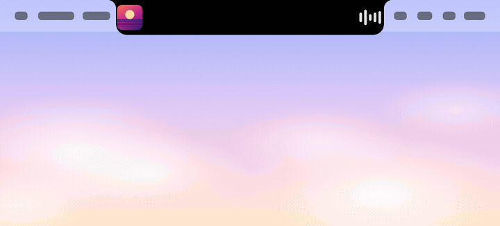
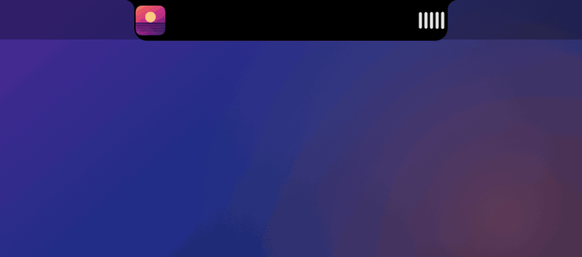
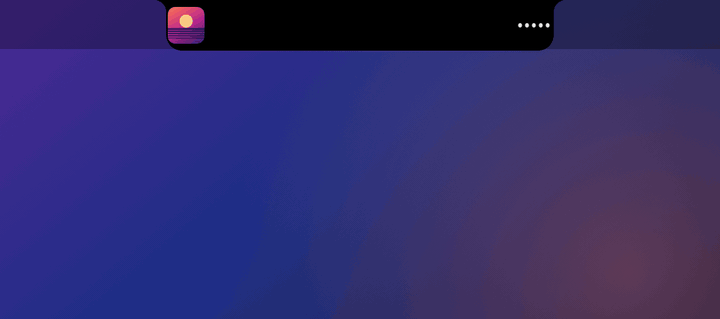

# NotchApp

[🇷🇺 Русский](README.md) · 🇬🇧 English

A macOS utility that lives in the MacBook notch. Hover over the notch and it expands into a panel. Collapsed, it stays almost invisible and shows an equalizer while music plays.

<p align="center">
  
</p>

## Features

### Music

Title, artwork, seeking and playback controls for any player, including Yandex Music. An equalizer by the notch moves with the audio.

<p align="center"></p>

### Claude

Tracks Claude Code sessions and chats in the Claude desktop app:

- working status, action count, timer and context usage;
- permission prompts and questions with buttons can be answered right from the notch;
- plan progress (for example, 2 of 5);
- a panel drops down with a soft glow when an agent needs an answer.

<p align="center"></p>

### Files, clipboard and translator

- **Files.** Screenshots and a temporary shelf: drop files into the panel and pick them up later.
- **Clipboard.** History of what you copied.
- **RU ↔ EN translator.** Uses the built-in macOS translation. Code identifiers in `camelCase` and `snake_case` are split into words before translating.

<p align="center"></p>

## Requirements

- macOS 15 or later, a MacBook with a notch (it also runs on others, but looks different)
- Xcode and [xcodegen](https://github.com/yonaskolb/XcodeGen): `brew install xcodegen`
- An Apple ID signed in to Xcode. A stable signature keeps macOS from resetting granted permissions after every rebuild.

## Install

```bash
git clone https://github.com/burr1t0/NotchApp.git
cd NotchApp
scripts/install.sh
```

The script builds the app, installs it to `/Applications` and launches it. Options: `--debug` for a debug build, `--no-launch` to skip launching afterwards.

`project.yml` contains the author's `DEVELOPMENT_TEAM`. Replace it with your own Team ID, otherwise signing will fail.

## Connecting Claude

Open the Claude tab in the panel. The app offers to connect itself:

- **Claude Code.** Adds hooks and a status line to `~/.claude/settings.json`. Your existing settings are preserved, and if the status line slot is already taken it is left alone. The "Отключить" (Disconnect) button in the same view removes it.
- **Chats in the Claude desktop app.** The "+ Чаты" (+ Chats) button registers a local MCP server, `notch-mcp.py`, in `claude_desktop_config.json` (a backup is made first). Edit that config only while the Claude app is closed, otherwise it will overwrite the file. You can also upload the skill from `skills/notch-status` to Claude, which makes chats report their status more often.

All helper files live in `~/.notchapp/`. The app sends nothing over the network: events travel through a local Unix socket.

### Limitations

- Plan limits (5-hour and weekly) are only available in terminal Claude Code. The desktop app does not expose them.
- Whether the model calls `notch_status` and `notch_confirm` in regular chats is up to the model. If no status shows up, ask for it in the prompt.

## Permissions

- **Audio capture.** Lets the equalizer react to volume. Audio is not recorded or transmitted anywhere.
- **Accessibility.** Only needed to send text into a Claude chat from the panel.

## Credits

Music data comes from [media-control](https://github.com/ungive/media-control) and [mediaremote-adapter](https://github.com/ungive/mediaremote-adapter) by Jonas van den Berg (BSD 3-Clause, license text in `Sources/NotchApp/MediaControl/LICENSE`).

This is an independent project, not affiliated with Anthropic or Yandex. Claude and Yandex Music are mentioned only to describe compatibility; they are trademarks of their owners.

## License

MIT. The bundled `media-control` and `MediaRemoteAdapter` keep their own license (BSD 3-Clause).
